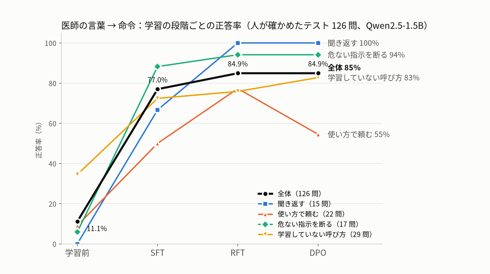

# 器械出しロボット：言葉で頼むと器具を手渡す（Physical AI 応用1 最終課題）

医師が「つまむやつちょうだい」「切るやつくれない？」のように手術室の言い方で話しかけると、
小型 LLM（Qwen2.5-1.5B）が命令（JSON）に変換し、ロボット（Isaac Sim 上の xArm6）が
カメラ画像から器具を見つけて手渡し台へ渡す／トレーへ戻す。どちらとも取れる言い方には聞き返し、
トレーにない物には「ありません」、器具を投げる・振り回すといった危ない指示は断る。最後に器具カウントを行う。

- LLM：人が書いた 37 文から SFT → RFT → DPO。人が確かめたテスト 126 問で正答率 **11.1% → 84.9%**
- ロボット：神視点なし（検出モデル＋深度だけで器具の位置と向きを求める）、物理で掴む。8 命令の台本を器具の置き方 3 通りで実行し、固定カメラ・手首カメラとも 24/24



## 中身

| 場所 | 内容 |
|---|---|
| `llm/` | データ作り・学習・評価（SFT / RFT / DPO）、確認用の画面（Gradio） |
| `robot/handover_sim.py` | Isaac Sim の器械出しシミュレーション（命令を順に実行して動画と結果 JSON を出す） |
| `robot/pickup_assets/` | xArm6（平行グリッパ）の USD/URDF、出発点の検出モデル `det_v2.pt`（YOLOv8n） |
| `robot/models/` | 青い作業台の場面で学習した検出モデル：固定カメラ用 `det_blue_fixed.pt`、手首カメラ用 `det_blue_wrist.pt` |
| `robot/train_det.py`, `robot/overnight_1031.sh` | 学習画像の作成とアノテーション（`handover_sim.py --stage dataset`）→ 検出モデルの学習 → デモ |
| `robot/download_i4h_assets.sh` | 手術器具の 3D モデル（NVIDIA Isaac for Healthcare）を取得する。モデル自体は再配布しない |
| `demo_pipeline.py` | 台本 → LLM → ロボットを通すデモ |
| `data/human/` | 人が作ったデータ：器具辞書、SFT の文、テスト問題の確認結果、デモ台本 |
| `data/generated/` | 学習・評価に使った問題（Qwen2.5-7B が作った医師の一言。正解はプログラムが決める） |
| `results/` | 各段階のテスト結果（種類別の正答率と全回答） |

## データと学習の流れ

1. **器具辞書**（人）：正式名・現場での呼び方・使う場面・テスト専用の呼び方。`llm/dict_app.py`
2. **SFT の文**（人）：医師のセリフに正解（渡す／戻す／聞き返す／ない／断る と器具）をクリックで付ける。`llm/sft_app.py` → `llm/build_sft.py`
3. **問題文**：状況と正解をプログラムで決め（`gen_scenarios.py`）、Qwen2.5-7B に医師の一言だけを作らせ、意味のずれを自動で除く（`gen_utterances.py`）
4. **テスト**：同じ方法で作った問題を人が 1 件ずつ確認（`review_app.py`）。学習には使わない
5. **学習**：`train_sft.py` → `collect.py`（1 問 8 回答えさせて採点）→ RFT（合格だけで学び直し）→ `train_dpo.py`（合格／不合格の組）。通しは `llm/chain_v2c.sh`
6. **評価**：`evaluate.py`（JSON・動作・器具を自動採点、種類別に集計）

学習データに外部の大規模 LLM の答えは使っていない（文は人、問題文の量は Qwen、答えはモデル自身とプログラムの採点）。

## 動かし方（Ubuntu 22.04、RTX 5090 で確認）

```bash
# LLM（Python 3.11）
cd llm && uv venv --python 3.11 .venv && uv pip install --python .venv --index-url https://download.pytorch.org/whl/cu128 torch
uv pip install --python .venv transformers trl peft accelerate datasets gradio matplotlib
PROMPT_V=2 python build_sft.py && bash chain_v2c.sh        # SFT → RFT → DPO と評価（数十分）

# ロボット（Isaac Sim 5.1、検出用に ultralytics 入りの別環境 robot/.venv-det）
bash robot/download_i4h_assets.sh
cd robot && uv venv --python 3.11 .venv-det && uv pip install --python .venv-det --index-url https://download.pytorch.org/whl/cu128 torch torchvision && uv pip install --python .venv-det ultralytics==8.4.9
cd .. && llm/.venv/bin/python demo_pipeline.py --out runs/demo --start llm/runs/v2c_dpo-c_start --adapter llm/runs/v2c_dpo-c
```

`demo_pipeline.py` は Isaac Sim の `python.sh` を `~/sasorobot/isaac-sim/python.sh` から呼ぶので、環境に合わせて書き換えてください。
起動時は環境変数 `OMNI_KIT_ACCEPT_EULA=YES ACCEPT_EULA=Y PRIVACY_CONSENT=N` が必要です。

## 分かったこと・課題

- DPO は「聞き返す」を伸ばしたが、「使い方で頼む」を 17 → 12/22 に下げた（全体は RFT と同じ 84.9%）
- メスとピンセットは取り違えやすいので、台の上や腕が写り込んだ画像も学習に入れた。器具カウントは数え漏れの防止が目的なので個数で数える
- 手渡し台は壁のない平らな台にし、置き場所を分けた（箱だと器具が重なり、壁ぎわで見つからなかった）
- シミュレーションのみ。実機、持ち手を医師に向けた差し出し、音声入力は今後の課題

## 使ったもの

Qwen2.5-1.5B-Instruct / Qwen2.5-7B-Instruct（Apache-2.0）、TRL・PEFT、NVIDIA Isaac Sim 5.1、
NVIDIA Isaac for Healthcare の手術器具モデル（取得スクリプトのみ）、xarm_ros2 の URDF（BSD-3-Clause）、Ultralytics YOLOv8（AGPL-3.0）
